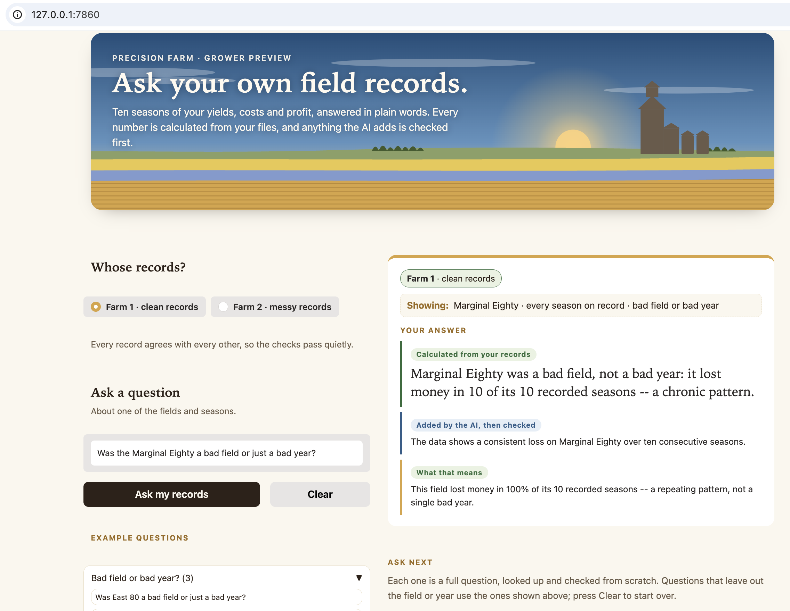
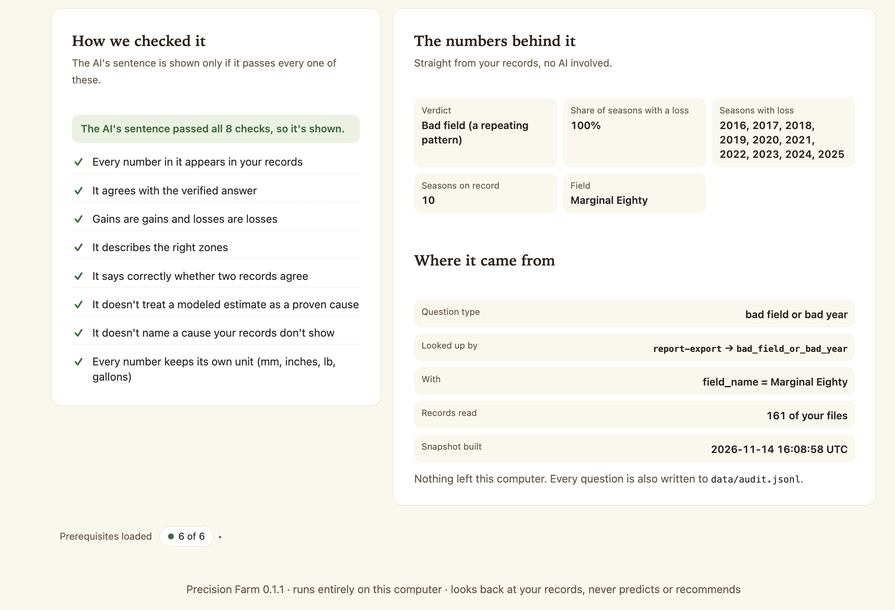
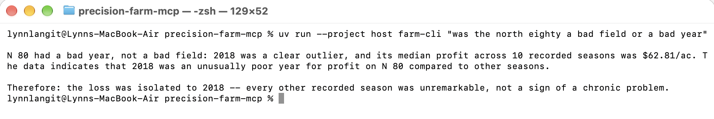

# Precision Farm MCP

**Version 0.1.1** (`uv run --project host farm-cli --version`)

Ask a plain-English question about ten seasons of your own farm records
(costs, yields, profit) and get an answer calculated from your own files,
on your own laptop. Never a prediction, never a guess, never sent anywhere.



## What you see in every answer

- **Calculated from your records.** Plain arithmetic on your files, written
  by code, not by the AI. It always comes first.
- **Added by the AI, then checked.** A small local AI model (Gemma 3 4B,
  `gemma3:4b`, through Ollama) may add one sentence. It is shown only if it
  passes all 8 checks: every number is in your records, it agrees with the
  answer, it names no cause your records don't show, and more.
- **AI sentence withheld.** The AI gets one try. If its sentence fails a
  check, you see what it tried to say and which check stopped it. The
  example under **When the AI is stopped** shows this happening.

The AI only turns your question into a lookup and offers that one
sentence. It never touches the data or does the arithmetic.

## Start here

| You are | Read |
|---|---|
| A grower trying it out | [docs/FARMER_GUIDE.md](docs/FARMER_GUIDE.md): setup, the example farms, loading your own records |
| Leading a session | [docs/EVAL_QUESTIONS.md](docs/EVAL_QUESTIONS.md): 15 demo questions, each with its known-correct answer |
| A developer | [Quick start](#quick-start), [docs/ARCHITECTURE.md](docs/ARCHITECTURE.md), [docs/VERIFICATION.md](docs/VERIFICATION.md) |

## Two example farms

The web app's **Whose records?** picker switches between two made-up North
Dakota farms with the same fields and the same true profits. **Farm
1** has clean records. **Farm 2** has the mistakes real records have: a
mistyped seed cost, a yield monitor out of calibration, a GPS dropout, a
field name spelled four ways. Ask a question, switch farms, and the app asks
it again: Farm 1's record checks pass, Farm 2's catch the problem.



## Quick start

Needs [uv](https://astral.sh/uv) and [Ollama](https://ollama.com) with
`gemma3:4b`. The [Farmer Guide](docs/FARMER_GUIDE.md) explains each step.

```bash
ollama pull gemma3:4b

# Farm 2: ten seasons of deliberately messy example data, then confirm each
# name, field change and column mapping once (MCP servers can't ask a human,
# so every query refuses until this has run)
uv run --project generator python -m farm_data_gen.cli --seed 42 --out data/synthetic
uv run --project host farm-ingest

# Farm 1: the same farm with clean records. Auto-approval is only allowed
# for this example data, whose answers are already known.
uv run --project generator python -m farm_data_gen.cli --seed 42 --clean --out data/synthetic-clean
uv run --project host farm-ingest --auto-approve-synthetic-only \
  --data-dir data/synthetic-clean --confirm-store data/confirmed_mappings_clean.json

uv run --project host farm-preflight   # checks everything above
uv run --project web farm-web          # growers: opens http://127.0.0.1:7860 (add --lan for shared Wi-Fi)
uv run --project host farm-cli "was the north eighty a bad field or a bad year"   # developers
```

Regenerating Farm 2's data also rewrites `docs/EVAL_QUESTIONS.md`; restart
`farm-web` afterwards, because it keeps its servers running between
questions.

`farm-cli` is the developers' interface. It answers through the same code
as the web app and adds a model-free `--intent` path that prints the raw
JSON result (`farm-cli --list-intents`).



**What v1 doesn't do:** no yield prediction, no recommendations, no crop
simulation, no satellite or drone imagery. It looks back at your records
only.

## Repository layout

| Path | What it is |
|---|---|
| `generator/` | Synthetic-data generator: 10 seasons, about a dozen fields, every defect (naming drift, splits/merges, sensor calibration error, messy spreadsheets) injected on purpose and recorded in `ground_truth.json` |
| `core/` (`farm_core`) | Shared library: DuckDB ingestion, field identity, reconciliation, profitability, audit log, governance |
| `servers/mcp-*` | Six FastMCP servers exposing `farm_core` as read-only MCP tools |
| `host/` (`farm_host`) | MCP client and router, `farm-ingest` (human confirmation), `farm-cli`, `farm-preflight` |
| `web/` (`farm_web`) | `farm-web`, the local Gradio app for growers, a thin layer over `farm_host` |
| `model/` (`farm_model`) | The bounded Gemma layer: question to lookup, the one added sentence, and the 8 checks |
| `docs/` | [FARMER_GUIDE](docs/FARMER_GUIDE.md), [ARCHITECTURE](docs/ARCHITECTURE.md), [VERIFICATION](docs/VERIFICATION.md), [EVAL_QUESTIONS](docs/EVAL_QUESTIONS.md), [PROJECT_HISTORY](docs/PROJECT_HISTORY.md) |

The MCP design is adapted from
[precision-medicine-mcp](https://github.com/lynnlangit/precision-medicine-mcp).

## License

Apache 2.0, see [LICENSE](LICENSE).
