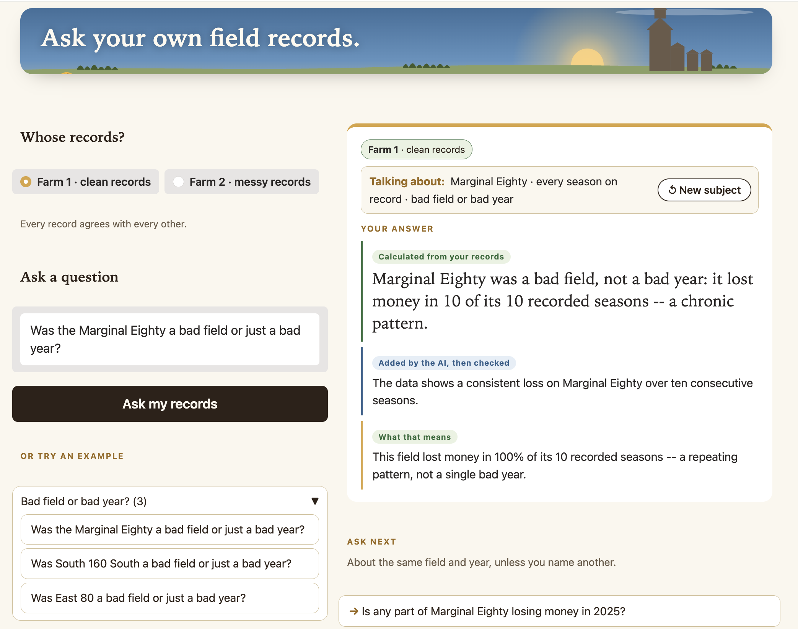

# Precision Farm MCP

**Version 0.2.0** · [What's new](CHANGELOG.md)

Ask a plain-English question about ten seasons of your own farm records
(costs, yields, profit) and get an answer calculated from your own files,
on your own laptop. Never a prediction, never a guess, never sent anywhere.



## Start here

| You are | Read |
|---|---|
| A grower trying it out | [docs/FARMER_GUIDE.md](docs/FARMER_GUIDE.md): setup, the example farms, loading your own records |
| A grower who wants to check the answers | [docs/YOUR_RECORDS.md](docs/YOUR_RECORDS.md): where the files are, the records behind each answer, the files your own farm needs |
| Leading a session | [docs/EVAL_QUESTIONS.md](docs/EVAL_QUESTIONS.md): 15 demo questions plus follow-up pairs, each with its known-correct answer |
| A developer | [docs/DEVELOPER.md](docs/DEVELOPER.md), [docs/ARCHITECTURE.md](docs/ARCHITECTURE.md), [docs/VERIFICATION.md](docs/VERIFICATION.md) |

## What you see in every answer

- **Calculated from your records.** Plain arithmetic written by code, not by the AI. It always comes first.
- **One AI sentence, checked.** A small local model (Gemma 3 4B via Ollama) may add one sentence, shown only if it passes all 9 checks. Otherwise it is withheld and you can see what it tried to say.
- **Show the records.** Every file, spreadsheet tab and row the answer used is listed, so you can check it by hand.

The web app comes with two made-up North Dakota example farms: **Farm 1**
has clean records, **Farm 2** has the mistakes real records have, and its
record checks catch them.

## Quick start

Needs [uv](https://astral.sh/uv) and [Ollama](https://ollama.com). The
[Farmer Guide](docs/FARMER_GUIDE.md) explains each step.

```bash
ollama pull gemma3:4b

# Farm 2 (messy records): generate, then confirm each name and mapping once
uv run --project generator python -m farm_data_gen.cli --seed 42 --out data/synthetic
uv run --project host farm-ingest

# Farm 1 (clean records): generate and auto-approve (example data only)
uv run --project generator python -m farm_data_gen.cli --seed 42 --clean --out data/synthetic-clean
uv run --project host farm-ingest --auto-approve-synthetic-only \
  --data-dir data/synthetic-clean --confirm-store data/confirmed_mappings_clean.json

uv run --project host farm-preflight   # checks everything above
uv run --project web farm-web          # opens http://127.0.0.1:7860
```

**What v1 doesn't do:** no yield prediction, no recommendations, no crop
simulation, no satellite or drone imagery. It looks back at your records
only.

The MCP design is adapted from
[precision-medicine-mcp](https://github.com/lynnlangit/precision-medicine-mcp).
Apache 2.0, see [LICENSE](LICENSE).
