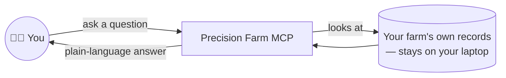

# Precision Farm MCP

**Version 0.1.0** (`uv run --project host farm-cli --version`)

A local-first, offline decision-support tool for one farmer's laptop. Ask a
plain-English question about your own farm's ten-season record — costs,
yields, profit — and get back an answer grounded entirely in your own
files, never a prediction or a guess.


Under the hood, a small local model (Gemma 3B via Ollama) only ever turns
the question into a structured lookup and may add one checked sentence of
context to an answer that deterministic code has already written — it never
touches the data or the arithmetic. Everything
else (field identity across years of renames/splits/merges, cost-ledger
ingestion, yield reconciliation, profitability) is deterministic Python,
checked against a synthetic ground-truth dataset, using an MCP (Model
Context Protocol) architecture adapted from
[precision-medicine-mcp](https://github.com/lynnlangit/precision-medicine-mcp).

**v1 is retrospective arithmetic only.** No yield prediction, no crop
simulation, no prescriptive recommendations, no remote sensing. Those are
later phases; building toward them now would be speculative structure.

## How it works



Every answer comes only from your own records — never a guess, never sent
anywhere else. If something in your data is unclear (a misspelled field
name, an odd spreadsheet column), the tool asks you once, up front, and
remembers your answer — it never guesses quietly.

For the full technical design — the MCP servers, the confirmation and
audit system, how the model is kept from inventing numbers — see
[docs/ARCHITECTURE.md](docs/ARCHITECTURE.md).

**If you're a farmer trying this out rather than a developer**, skip
straight to [docs/FARMER_GUIDE.md](docs/FARMER_GUIDE.md) — a plain-language
walkthrough of what this does, how to set it up, how to try it with the
included example data, and how to eventually load your own records.

## Quick start

```bash
# To start ollama --> in a terminal, leave this window open
ollama serve
# To verify models --> in a second terminal
ollama list
# cd into the folder where you cloned this repo
cd precision-farm-mcp
```

```bash
# Generate ten seasons of synthetic (deliberately messy) farm data
uv run --project generator python -m farm_data_gen.cli --seed 42 --out data/synthetic

# Confirm every naming-drift alias, identity event, and column mapping once,
# interactively -- MCP servers are non-interactive stdio processes and can
# never do this themselves, so every query refuses until this has run.
uv run --project host farm-ingest

# Ask a question (requires a local Ollama with gemma3:4b pulled)
ollama pull gemma3:4b
uv run --project host farm-preflight  # confirms everything above is actually working
uv run --project host farm-cli "was the north eighty a bad field or a bad year"
```

## Grower web app

For testing with growers there is a local web app on top of the same host
code. It answers through exactly the same path as `farm-cli`, and next to
every answer it shows the lesson behind it: which sentence was calculated
from the records, which sentence the AI added, every check that sentence had
to pass (or the attempt it blocked), the figures it came from, and which MCP
server answered.

```bash
# After the Quick start steps above (data generated, farm-ingest run, Ollama up):
uv run --project web farm-web          # opens http://127.0.0.1:7860
uv run --project web farm-web --lan    # also reachable by other laptops on the same Wi-Fi
```

It only listens on this computer unless you pass `--lan`, never creates a
public share link, sends no usage analytics, and writes every question to
`data/audit.jsonl` like the CLI. Developers keep using `farm-cli`.

## Repository layout

| Path | What it is |
|---|---|
| `generator/` | Deterministic synthetic-data generator: 10 seasons, ~12 fields, every defect (naming drift, splits/merges, sensor calibration error, messy spreadsheets) deliberately injected and recorded in `ground_truth.json` |
| `core/` (`farm_core`) | Shared library: DuckDB ingestion, field-identity resolution, reconciliation, the profitability engine, audit log, governance |
| `servers/mcp-*` | Six FastMCP servers exposing `farm_core` as MCP tools (Pydantic I/O, `readOnlyHint`, structured refusals, a `modeled` field reserved for model output) |
| `host/` (`farm_host`) | The host application: MCP client/router (stdio, untrusted-text sanitization), `farm-ingest` (human-present confirmation) and `farm-cli` (query, fails closed) |
| `web/` (`farm_web`) | `farm-web`, the local Gradio app for grower testing: a thin layer over `farm_host` with a North Dakota prairie theme |
| `model/` (`farm_model`) | The bounded Gemma layer: question → query, result → narration, plus the verification that keeps it bounded |
| `docs/FARMER_GUIDE.md` | Plain-language setup and usage guide, no programming background assumed |
| `docs/ARCHITECTURE.md` | The full technical architecture and diagram |
| `docs/EVAL_QUESTIONS.md` | Eleven independent evaluation questions, each verifiable against `ground_truth.json` |
| `docs/PROJECT_HISTORY.md` | The phase history and roadmap |

## The three hard problems

1. **Field identity across ten years.** A field's name isn't a stable key —
   it drifts in the farmer's own spreadsheet, gets formally renamed, and
   stops meaning anything across a split or merge. `core/src/farm_core/field_identity.py`
   resolves the real ten-year timeline from raw files alone, using acreage
   continuity (not string matching) as the signal — proven first, since
   it's the riskiest piece.
2. **Spreadsheet ingestion with human confirmation.** Every farmer's ledger
   is different. A column-mapping is proposed, confirmed once per header
   shape by `farm-ingest` with a human physically present, and persisted for
   reuse — an MCP server is a non-interactive stdio subprocess and can never
   ask, so query time only ever reads what was already confirmed, refusing
   rather than guessing if it wasn't.
3. **Reconciliation.** Two independent paths exist to several figures
   (yield monitor vs. scale tickets, ledger cost vs. as-applied cost).
   Where they disagree is a feature, surfaced neutrally, never asserted as
   the farmer's records being wrong.

## Verification

273 tests across the four packages, including all 11 evaluation questions
from `docs/EVAL_QUESTIONS.md` at the tool level, all green in CI. The host
and model suites need Ollama running with `gemma3:4b`; without it, only the
tests that call the model fail.

```bash
for pkg in generator core host model; do (cd $pkg && uv run pytest -q); done
```

The same 11 questions also run end to end in plain English — Gemma parses
each one, the host routes it, and the answer's figures, summary line, or
refusal are checked. This suite is slow and opt-in:

```bash
uv run --project host pytest -m eval_nl host/tests
```

Notably:

- 💰 **Profit matches ground truth** for every field/season without a
  deliberate defect
- 🔍 **Every injected defect is caught by its ID** — including
  `DEF-ALIASTIE`, proving auto-approval gives a confidently *wrong* answer
  where confirmation gives the right one
- 🌐 **Zero non-loopback network calls** (`test_no_network.py`)
- 🔗 **Audit log stays tamper-evident** under real concurrent writes from
  the host process and two live server subprocesses
  (`test_audit_multiprocess.py`)
- 🛡️ **Prompt injection has no effect** — `DEF-INJECTION` proves the
  narration is unaffected, not just non-crashing (`test_injection_defect.py`)
- 🚪 **The model-free query path really is model-free** —
  `farm-cli --intent ...` reaches an answer with zero `ollama.chat` calls,
  verified directly (`test_structured_path_never_calls_ollama`)
- ✅ **Answers lead with verified text** — every answer opens with a
  deterministic template sentence built from the tool result. The model may
  add one sentence of context, shown only if every number traces to the
  payload, no verdict is contradicted, and it passes five meaning checks
  (sign, zone premise, reconciliation, attribution, unsupported cause);
  otherwise it is dropped after one retry
- 📊 **Governance is measurable, not just asserted** — `farm-metrics`
  reports HITL catch rate, tool grounding, narration faithfulness, and
  sovereignty integrity straight from the audit log

## License

Apache 2.0 — see [LICENSE](LICENSE).
