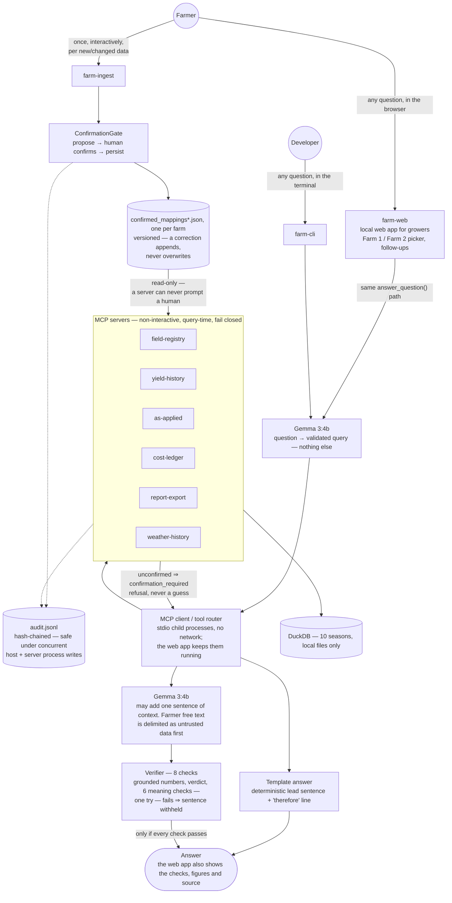
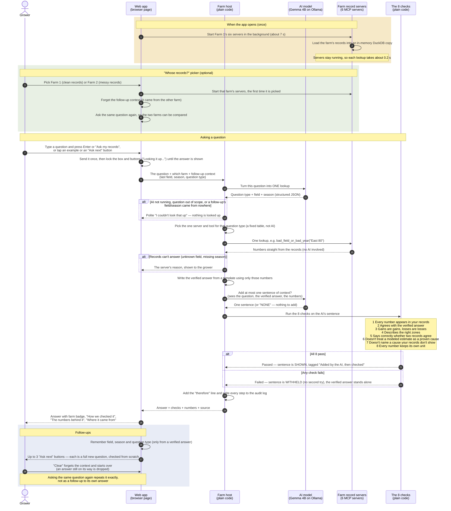

# Architecture

The technical design behind Precision Farm MCP. For the short,
farmer-facing picture, see the [README](../README.md#how-it-works).

Gemma touches a question at exactly two points: parsing it into a
validated query, and adding at most one sentence to an answer a
deterministic template has already written. That sentence is shown only if
it passes all 8 checks in `model/src/farm_model/verification.py`;
otherwise it is withheld and the template answer stands alone. Gemma never
sees raw data, computes a number, or resolves an ambiguous name; the model
layer can't import a database or MCP client
(`model/tests/test_model_bounded.py`).

Confirmation is structural. A server can't prompt a human, so `farm-ingest`
confirms and persists every alias, event and mapping once, with a human
present; servers read that record and refuse (`confirmation_required`)
rather than guess. Every decision lands in one hash-chained,
concurrency-safe audit log. Ledger notes reaching Gemma are delimited as
untrusted, excluded from grounding, and never followed as instructions,
proven against an injected-prompt defect.

## How a question flows in the web app

Built from `web/src/farm_web/app.py`, `host/src/farm_host/cli.py` and
`model/src/farm_model/narrator.py`. Edit this block when that flow changes.

## Component status

| Component | Status | Note |
|---|---|---|
| Ingest/query confirmation split, `ConfirmationGate` | Built | |
| 6 MCP servers, `farm-cli`, `farm-ingest` | Built | Every server has at least one question type routed to it |
| Weather, soil and as-applied questions | Built | `SEASON_WEATHER`, `FIELD_SOIL` (`weather-history`) and `APPLIED_INPUTS`, `NITROGEN_HISTORY` (`as-applied`), computed in `core/field_conditions.py`. Nitrogen is always reported in lb N/ac, converting gal/ac of UAN 32%; corn and soybean N are never compared. A `units` check rejects a sentence that puts the wrong unit on a number. These are records, not causes: none of them says why a season went badly |
| Grower web app (`farm-web`, `web/`) | Built | Thin Gradio layer over `farm_host.cli.answer_question`, so it can't drift from the CLI or evals. Shows the template sentence, the checked AI sentence or a "withheld" note, the checks, figures and source. The "When the AI is stopped" example, "Was East 80 a bad field or just a bad year?" (eval 2), shows a withheld sentence: gemma3:4b blames the weather, which no record supports. `NARRATION_SEED` makes it repeatable on a given machine; `scripts/probe_narration.py` re-checks it against the real model. Local only unless `--lan` |
| Persistent servers (`farm_host.server_pool`) | Built | All six servers start once in the background (~7 s) and stay up, so a lookup takes ~0.2 s instead of ~4 s. Restart the app after regenerating data |
| Farm picker (`farm_host.farms`) | Built | Farm 1: clean records (`data/synthetic-clean`, generator `--clean`). Farm 2: messy records (`data/synthetic`). Same fields and true profits. One server pool per farm via `FARM_DATA_DIR`/`FARM_CONFIRM_STORE`; Farm 1 starts at app open, Farm 2 on first pick. Switching clears follow-ups and re-asks the question; every answer carries a farm badge |
| Follow-ups (`farm_host.followups`) | Built | Only the last verified answer's field, season and question type carry over; the parser refuses a follow-up whose field or season came from nowhere. A "Showing:" line names what was answered, plus up to 3 "Ask next" buttons |
| Template-first narration (`narrate_verified`) | Built | Template sentence always leads; the model may add one sentence, kept only if it passes all 8 checks (grounded, verdict, sign, zone premise, reconciliation, attribution, unsupported cause, units). One try by default (`max_attempts=1`), so a failing sentence is withheld, not rewritten |
| Hash-chained, concurrency-safe audit log | Built | Host and every server write to it (fixed in Phase A) |
| Provenance (`modeled` subtree), grounding split | Built | `modeled` is filled by weather attribution on `bad_year` verdicts, `null` elsewhere by design |
| Untrusted-text handling, payload capping | Built | |
| Governance metrics (`farm-metrics`) | Built | Includes an `attribution_backtest` section |
| Weather ingestion, attribution model | Built | Synthetic weather + soil AWC (`weather-history`); `core/expectation.py` splits a shortfall into `season_effect` and `residual`; `EXPLAIN_SHORTFALL` intent |
| Zone-level (sub-field) profitability | Built | `core/zone_profitability.py`, 2x2 zones per field, as-applied seasons only |
| Readiness check (`farm-preflight`) | Built | Checks uv, Ollama, model, data and ingest, then runs a live query |
| Non-interactive ingest (`--auto-approve-synthetic-only`) | Built | Refused outside `data/synthetic/`; DEF-ALIASTIE shows why it must never touch real records |
| Model-free query path (`farm-cli --intent`) | Built | No `ollama.chat` call anywhere on this path (`test_structured_path_never_calls_ollama`) |
| Deterministic "therefore" line (`therefore.py`) | Built | Template-built, omitted where there is no verdict to restate |
| Clear failures (`ParseFailure.kind`, exit codes) | Built | A dead model and an out-of-scope question get different messages; CLIs exit 1 on any refusal |
| CI (`.github/workflows/tests.yml`) | Built | PRs: `generator`+`core` on Ubuntu and Windows. Nightly/manual: `host`+`model` with real Ollama on Ubuntu. Docs-only changes skip CI; `web` and the docs test run locally |
| **Diverged:** confirmation at query time | — | MCP servers can't prompt a human, so confirmation moved to ingest |
| **Diverged:** zone cost is field-uniform | — | The data has no per-zone cost (ledger is per acre), so only yield is zone-resolved |
| Remote sensing | Deferred | Out of scope by design; not scheduled |
| Agronomy reference data | Deferred | Only needed if an absolute (not relative) expectation model is ever required |
| Prescriptive crop model / recommendations | Deferred | Out of scope (see README); not scheduled |
| Live weather / any sync boundary | Deferred | Not scheduled; see below |

## Known future tensions

**Weather is synthetic, on purpose.** With real weather the true split of
a shortfall is unknowable, so an attribution claim would be unfalsifiable.
With generated weather it's known exactly: forcing one season into drought
is correctly attributed to weather, not management
(`core/tests/test_expectation.py`).

Live weather would need a sync boundary and would weaken "no outbound
network" to "no network at query time". **`host/tests/test_no_network.py`
is not weakened in this build**; any change that touches it should update
this section first.

## See also

- [README](../README.md) — the simple picture, quick start, and repository layout
- [FARMER_GUIDE.md](FARMER_GUIDE.md) — plain-language setup and usage guide
- [VERIFICATION.md](VERIFICATION.md) — how to run the tests and what they prove
- [EVAL_QUESTIONS.md](EVAL_QUESTIONS.md) — fifteen independent evaluation questions
- [PROJECT_HISTORY.md](PROJECT_HISTORY.md) — the phase history
