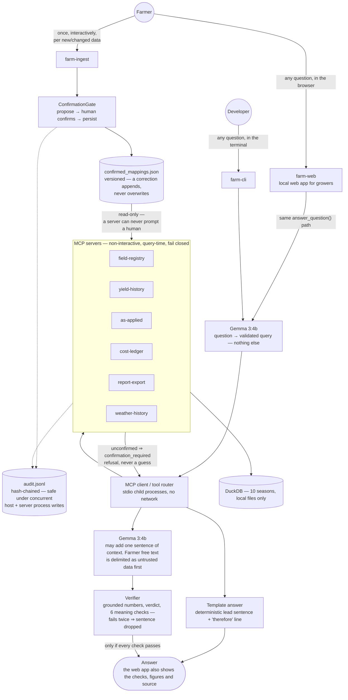

# Architecture

The technical design behind Precision Farm MCP. For the short,
farmer-facing picture, see the [README](../README.md#how-it-works).

Gemma touches a question at exactly two points — parsing it into a
validated query, and adding at most one sentence of context to an answer
that a deterministic template has already written. That sentence is shown
only if it passes every check in `model/src/farm_model/verification.py`;
otherwise the template answer stands alone. It never sees raw data,
computes a number, or resolves an ambiguous name itself; the model layer
can't import a database or MCP client (`model/tests/test_model_bounded.py`).

Confirmation is structural. A server can't prompt a human, so `farm-ingest`
confirms and persists every alias, event, and mapping once, with a human
present; servers read that record, refusing (`confirmation_required`)
rather than guessing. Every decision lands in one hash-chained,
concurrency-safe audit log. Ledger notes reaching Gemma are delimited as
untrusted, excluded from grounding, and never followed as instructions —
proven against an injected-prompt defect.

## Component status

| Component | Status | Note |
|---|---|---|
| Ingest/query confirmation split, `ConfirmationGate` | Built | |
| 6 MCP servers, `farm-cli`, `farm-ingest` | Built | Every server has at least one question type routed to it, so the web app warms all six |
| Weather, soil and as-applied questions | Built | `SEASON_WEATHER`, `FIELD_SOIL` (`weather-history`) and `APPLIED_INPUTS`, `NITROGEN_HISTORY` (`as-applied`), computed in `core/field_conditions.py`. Nitrogen is always reported in lb N/ac, converting gal/ac of UAN 32%; corn and soybean N are never compared. A `units` check rejects a sentence that puts the wrong unit on a number. These are records, not causes: none of them says why a season went badly |
| Grower web app (`farm-web`, `web/`) | Built | Thin Gradio layer over `farm_host.cli.answer_question`, so it can't drift from the CLI or evals; shows the template sentence, the checked AI sentence (or the blocked one), figures and source. Follow-ups carry only the last verified answer's field, season and question type (`farm_host.followups`); a "Showing:" line names what was answered. Keeps the MCP servers running for the session (`farm_host.server_pool`) so a question skips the ~4 s server start and snapshot build. Local only unless `--lan` |
| Template-first narration (`narrate_verified`) | Built | Template sentence always leads; the model may add one sentence, kept only if grounded and it passes all checks, with one retry naming the failed check |
| Hash-chained, concurrency-safe audit log | Built | Host and every server write to it (fixed in Phase A) |
| Provenance (`modeled` subtree), grounding split | Built | `modeled` is filled by weather attribution on `bad_year` verdicts, `null` elsewhere by design |
| Untrusted-text handling, payload capping | Built | |
| Governance metrics (`farm-metrics`) | Built | Includes an `attribution_backtest` section |
| Weather ingestion, attribution model | Built | Synthetic weather + soil AWC (`weather-history`); `core/expectation.py` splits a shortfall into `season_effect` and `residual`; `EXPLAIN_SHORTFALL` intent |
| Zone-level (sub-field) profitability | Built | `core/zone_profitability.py`, 2x2 zones per field, as-applied seasons only |
| Readiness check (`farm-preflight`) | Built | Checks uv, Ollama, model, data and ingest, then runs a live query |
| Non-interactive ingest (`--auto-approve-synthetic-only`) | Built | Refused outside `data/synthetic/`; DEF-ALIASTIE shows why it must never touch real records |
| Model-free query path (`farm-cli --intent`) | Built | No `ollama.chat` call anywhere on this path (`test_structured_path_never_calls_ollama`) |
| Deterministic "therefore" line (`therefore.py`) | Built | Template-built, omitted where there is no verdict to restate |
| Clear failures (`ParseFailure.kind`, exit codes) | Built | A dead model and an out-of-scope question get different messages; CLIs exit 1 on any refusal |
| CI (`.github/workflows/tests.yml`) | Built | PRs: `generator`+`core` on Ubuntu and Windows. Nightly/manual: `host`+`model` with real Ollama on Ubuntu. Docs-only changes skip CI; `web` and the docs test run locally |
| **Diverged:** confirmation at query time | — | MCP servers can't prompt a human, so confirmation moved to ingest |
| **Diverged:** zone cost is field-uniform | — | The data has no per-zone cost (ledger is per acre), so only yield is zone-resolved |
| Remote sensing | Deferred | Out of scope by design |
| Agronomy reference data | Deferred | Not needed by the relative expectation model |
| Prescriptive crop model / recommendations | Deferred | Out of scope (see README) |
| Live weather / any sync boundary | Deferred | See known future tensions |

## Roadmap

| Deferred component | Needed by |
|---|---|
| Live weather / sync boundary | Not yet scheduled — see known future tension |
| Remote sensing | Not yet scheduled |
| Prescriptive crop model | Not yet scheduled |
| Agronomy reference data | Not yet scheduled — only if an absolute (not relative) expectation model is ever required |

## Known future tensions

**Weather is synthetic, on purpose.** With real weather the true
decomposition of a shortfall is unknowable, so an attribution claim would
be unfalsifiable; with generated weather it's known exactly, because the
generator caused it — verified directly by forcing one season's weather
into a real drought and confirming `core/expectation.py`'s attribution
correctly assigns it to weather, not management (`core/tests/
test_expectation.py`). Synthetic weather also means Phase C added zero new
attack surface to `host/tests/test_no_network.py`'s guarantee.

Live weather, if ever added, would need a sync boundary and would weaken
"no outbound network" to "no network at query time" — a real, deliberate
future divergence from the current all-local design. That trade-off is
recorded here now, deliberately, rather than discovered later:
**`test_no_network.py` is not weakened in this build**, and any future
change that touches it should update this section first.

## See also

- [README](../README.md) — the simple picture, quick start, and repository layout
- [FARMER_GUIDE.md](FARMER_GUIDE.md) — plain-language setup and usage guide
- [VERIFICATION.md](VERIFICATION.md) — how to run the tests and what they prove
- [EVAL_QUESTIONS.md](EVAL_QUESTIONS.md) — fifteen independent evaluation questions
- [PROJECT_HISTORY.md](PROJECT_HISTORY.md) — the phase history and roadmap
