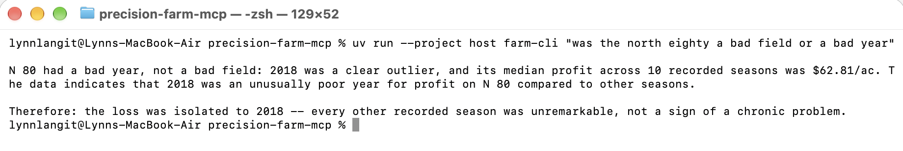

# Developer notes

For the overview and quick start, see the [README](../README.md). How the
pieces fit together is in [ARCHITECTURE.md](ARCHITECTURE.md), and how it is
tested is in [VERIFICATION.md](VERIFICATION.md).

## Quick start notes

- Every query refuses until `farm-ingest` has run for that farm: MCP servers
  can't ask a human, so each name, field change and column mapping is
  confirmed once up front. `--auto-approve-synthetic-only` is allowed only
  for the example data, whose answers are already known.
- Regenerating Farm 2's data also rewrites [EVAL_QUESTIONS.md](EVAL_QUESTIONS.md).
  Restart `farm-web` afterwards, because it keeps its servers running
  between questions.
- `farm-web --lan` shares the app on the local Wi-Fi. It is local only
  otherwise.

## farm-cli

`farm-cli` is the developers' interface. It answers through the same code
as the web app and adds a model-free `--intent` path that prints the raw
JSON result (`farm-cli --list-intents`).

```bash
uv run --project host farm-cli "was the north eighty a bad field or a bad year"
uv run --project host farm-cli --version
```



## Repository layout

| Path | What it is |
|---|---|
| `generator/` | Synthetic-data generator: 10 seasons, about a dozen fields, every defect (naming drift, splits/merges, sensor calibration error, messy spreadsheets) injected on purpose and recorded in `ground_truth.json` |
| `core/` (`farm_core`) | Shared library: DuckDB ingestion, field identity, reconciliation, profitability, audit log, governance |
| `servers/mcp-*` | Six FastMCP servers exposing `farm_core` as read-only MCP tools |
| `host/` (`farm_host`) | MCP client and router, `farm-ingest` (human confirmation), `farm-cli`, `farm-preflight` |
| `web/` (`farm_web`) | `farm-web`, the local Gradio app for growers, a thin layer over `farm_host` |
| `model/` (`farm_model`) | The bounded Gemma layer: question to lookup, the one added sentence, and the 8 checks |
| `docs/` | [FARMER_GUIDE](FARMER_GUIDE.md), [YOUR_RECORDS](YOUR_RECORDS.md), [ARCHITECTURE](ARCHITECTURE.md), [VERIFICATION](VERIFICATION.md), [EVAL_QUESTIONS](EVAL_QUESTIONS.md), [PROJECT_HISTORY](PROJECT_HISTORY.md); release notes in [CHANGELOG](../CHANGELOG.md) |
