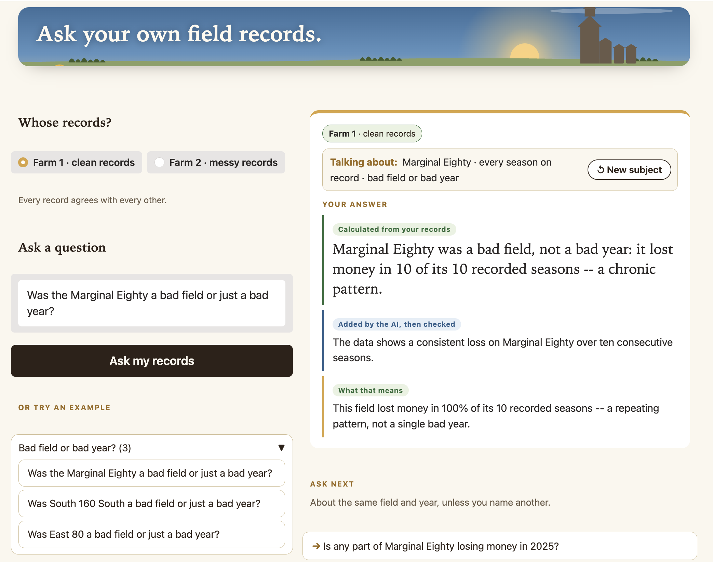
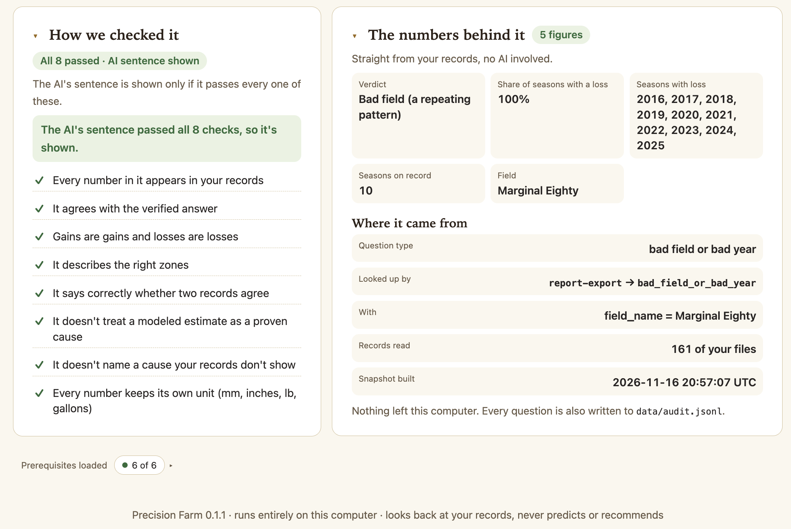

# Precision Farm MCP — A Guide for Farmers

How to try the tool on your laptop with example data, then point it at your
own farm's records. You will type a few commands into a terminal; no
programming is needed. Stuck? See [Troubleshooting](#troubleshooting).

**In this guide:** [What is this?](#what-is-this) ·
[What you'll need](#what-youll-need) ·
[Step 1: Try it with example data](#step-1-try-it-with-example-data-first) ·
[Using the app](#using-the-app) ·
[Step 2: Load your own farm's data](#step-2-load-your-own-farms-data) ·
[Troubleshooting](#troubleshooting)

## What is this?

Ask a plain-English question about your farm's records (costs, yields,
profit) and get an answer worked out from your own files, never a guess or
a prediction.

> **You ask:** "Was the north eighty a bad field or just a bad year?"
>
> **Calculated from your records:** "N 80 had a bad year, not a bad field:
> 2018 was a clear outlier, and its median profit across 10 recorded
> seasons was $62.81/ac."
>
> **Added by the AI, then checked:** "The data indicates that 2018 was an
> unusually poor year for profit on N 80 compared to other seasons."

It knew "north eighty" means the field your maps call "N 80" because you
confirmed that once, in Step 1.

| Promise | How |
|---|---|
| Your data stays on your laptop | Nothing is sent to a server or the internet. [ARCHITECTURE.md](ARCHITECTURE.md) and [VERIFICATION.md](VERIFICATION.md) show how that's enforced and tested |
| The AI never does the numbers | A small local AI model only turns your question into a lookup, and may add one sentence, shown only if it passes every check |
| It only looks back | v1 doesn't predict yield, recommend what to plant, or read satellite or drone images |

## What you'll need

Install these once:

| What | How |
|---|---|
| **The code** | On the GitHub page, click the green **Code** button, then **Download ZIP**, and unzip it somewhere you'll remember. That folder is "the project folder" below. (`git clone <url>` works too and makes updates easier.) |
| **`uv`**, which runs the Python programs | Mac or Linux: `curl -LsSf https://astral.sh/uv/install.sh \| sh`. Windows (PowerShell): `powershell -ExecutionPolicy ByPass -c "irm https://astral.sh/uv/install.ps1 \| iex"`. Others: [astral.sh/uv](https://astral.sh/uv). Tested on Mac and Linux, not Windows |
| **Ollama**, which runs the local AI model | Install from [ollama.com](https://ollama.com), then run `ollama pull gemma3:4b` (about 3-4 GB, once). It must be running whenever you ask a question; it usually starts by itself |

No internet connection is needed to answer a question once this is set up.
To check everything is working, open a terminal in the project folder and
run:

```bash
uv run --project host farm-preflight
```

It checks `uv`, Ollama, the model and (after Step 1) both example farms,
then asks a real question, and tells you exactly what to fix. Re-run it
whenever something seems off.

## Step 1: Try it with example data first

The project comes with ten seasons of made-up records for a North Dakota
corn and soybean farm, in two versions:

| Farm | Records | Folder |
|---|---|---|
| **Farm 1** | Clean | `data/synthetic-clean/` |
| **Farm 2** | Messy, like real ones: misspelled field names, a field split in two, a spreadsheet column that changes meaning one year | `data/synthetic/` |

Both are the same farm with the same true profits; only the record keeping
differs. In a terminal in the project folder:

```bash
# Farm 2: generate the records, then confirm how to read them (once)
uv run --project generator python -m farm_data_gen.cli --seed 42 --out data/synthetic
uv run --project host farm-ingest

# Farm 1: generate and approve automatically (allowed for example data only)
uv run --project generator python -m farm_data_gen.cli --seed 42 --clean --out data/synthetic-clean
uv run --project host farm-ingest --auto-approve-synthetic-only --data-dir data/synthetic-clean --confirm-store data/confirmed_mappings_clean.json
```

### Answering the farm-ingest questions

`farm-ingest` is the only time the tool asks you anything. For Farm 2 it
asks 14 questions like this one:

```
[confirm] naming_drift_alias: Cost ledger name 'north eighty' in season 2017
  proposal: {'canonical_boundary_name': 'N 80'}
  confidence: low
  approve? [y/N]:
```

Type `y` for every question except one. **The example data includes one
wrong proposal on purpose**, to show the tool asks rather than guesses:

```
[confirm] naming_drift_alias: Cost ledger name 'Hom Corner' in season 2023 has 2 acreage candidates, not exactly 1
  proposal: {'canonical_boundary_name': 'Section Corner'}
  confidence: low
  approve? [y/N]: N
  candidates: ['Section Corner', 'Home Quarter', 'South 160 North']
  correct canonical_boundary_name (blank to reject): Home Quarter
```

"Hom Corner" means Home Quarter: two fields are the same size that year, so
acres can't tell them apart. Type `N`, then `Home Quarter`.

On your own data, don't rely on the `confidence` word: "north eighty" shows
`low` and is right. The warning sign is a line like **"has 2 acreage
candidates"**: the tool can't tell two fields apart and needs you to say
which.

## Using the app

```bash
uv run --project web farm-web
```

A browser tab opens at `http://127.0.0.1:7860`. "Prerequisites loaded: 6 of
6" at the bottom means Ollama, the model and both farms are ready (click it
for the list). If one fails, it moves to the top, open, with the command
that fixes it.



| To | Do this |
|---|---|
| Pick the records | **Whose records?** Farm 1 or Farm 2. Switching asks the same question again, so you can compare. The first switch to Farm 2 takes a few seconds |
| Ask | Type a question, then **Enter** or **Ask my records** (Shift+Enter for a new line). The button reads "Looking it up..." and the box locks until the answer arrives, so a question is never sent twice |
| Use an example | Open **Example questions (5 types)**, pick a type, tap a question |
| Ask a follow-up | Type "What about East 80?" or "And in 2023?", or tap an **Ask next** button. **Talking about:** shows the field, season and question it answered. Every follow-up is looked up and checked from scratch |
| Start over | **↺ New subject** on the Talking about line forgets the field and year and clears the answer |

Each answer has labelled parts:

| Part | What it is |
|---|---|
| **Calculated from your records** (green) | Plain arithmetic on your files, written by code. Always first |
| **Added by the AI, then checked** (blue) | At most one AI sentence, one try, shown only if it passes all 9 checks |
| **AI sentence withheld** | The sentence failed a check. **See what it wrote** shows what it tried to say and which check stopped it; **How we checked it** opens by itself |
| **How we checked it** | The 9 checks, folded to a summary such as "All 9 passed" |
| **The numbers behind it** | The exact figures, and **Where it came from**: the lookup used and **Show the records**, every file, tab and row behind the answer, so you can check it by hand ([how](YOUR_RECORDS.md#show-the-records-behind-an-answer)) |



**Two questions worth trying:**

| Question | What it shows |
|---|---|
| "Does the seed cost on Sheyenne Bottom in 2022 look right?" on Farm 1, then Farm 2 | Farm 1 says the costs are in line; Farm 2 catches the mistyped seed cost |
| Example questions → **Bad field or bad year?** → "Was East 80 a bad field or just a bad year?" | The AI often adds that 2020's loss was due to unusual weather. Your records show 2020 was a bad year, not why, so that sentence is withheld (what the AI writes can vary by computer) |

[EVAL_QUESTIONS.md](EVAL_QUESTIONS.md) lists fifteen questions, each with
its known-right answer, to check the tool against before trusting it with
your own records.

**Good to know**

- The app runs only on this laptop: no public link, no usage data. Every
  question is written to `data/audit.jsonl` on your laptop.
- **Session history** (link at the bottom of the page, and in "How we
  checked it") reads that log back: each question, what was looked up, the
  AI sentence that was shown or withheld and the check that stopped it. One
  run of the app is one session; pick an earlier one from the list. A green
  "Log intact" line means no entry was edited since it was written.
- To let others on the same Wi-Fi use it, start it with
  `uv run --project web farm-web --lan`, and only on a network you trust.
- The app keeps its lookup servers running between questions. Restart it
  after regenerating data or re-running `farm-ingest`.
- The same question works in the terminal:
  `uv run --project host farm-cli "was the north eighty a bad field or a bad year"`.
  The terminal adds a "Therefore:" line the web app leaves out.

## Step 2: Load your own farm's data

**Read this whole section first.** v1 expects your records in the same
layout as the example data, and reformatting them is the fiddliest part. If
you know a tech-savvy friend, agronomist or ag-tech consultant, ask for a
hand the first time.

1. Put your files in `data/synthetic/`, in place of Farm 2's. Every file
   name and column heading you need is in
   **[YOUR_RECORDS.md](YOUR_RECORDS.md#the-files-you-need-for-your-own-farm)**.
   Headings must match exactly; when one is unclear, open the same file in
   `data/synthetic-clean/`.
2. For a clean start, delete `data/confirmed_mappings.json` and
   `data/audit.jsonl` (your confirmations and the question log). Both are
   recreated.
3. Confirm your field names and columns once, then ask:

```bash
uv run --project host farm-ingest
uv run --project web farm-web
# or in the terminal
uv run --project host farm-cli "which fields made money last year"
```

When you add a new season later, `farm-ingest` only asks about what's new.

## Troubleshooting

| What you see | What to do |
|---|---|
| The browser tab didn't open, or can't connect | Check the terminal running `farm-web` is still open, then go to `http://127.0.0.1:7860` yourself. If another program uses that port, add `--port 7861` |
| A "confirmation_required" refusal | `farm-ingest` hasn't run for this data, or the data changed since. Run `farm-ingest` again |
| A plain refusal instead of an answer | By design: the tool refuses rather than guesses (an unknown field name, a season outside your records, a prediction or recommendation). Check the field name and season match your data, or rephrase |
| "Couldn't reach the local model" | A setup problem, not your question: Ollama isn't running or the model isn't pulled. Run `uv run --project host farm-preflight` |
| A whole season missing, or numbers that don't add up | Compare your file names and column headings with `data/synthetic-clean/`; a misnamed file or column is the usual cause |

## Where to go next

| Read | For |
|---|---|
| [YOUR_RECORDS.md](YOUR_RECORDS.md) | Where each number comes from, and how to check one by hand |
| [EVAL_QUESTIONS.md](EVAL_QUESTIONS.md) | Fifteen questions with known-right answers |
| [README](../README.md#start-here) | Every other doc |
