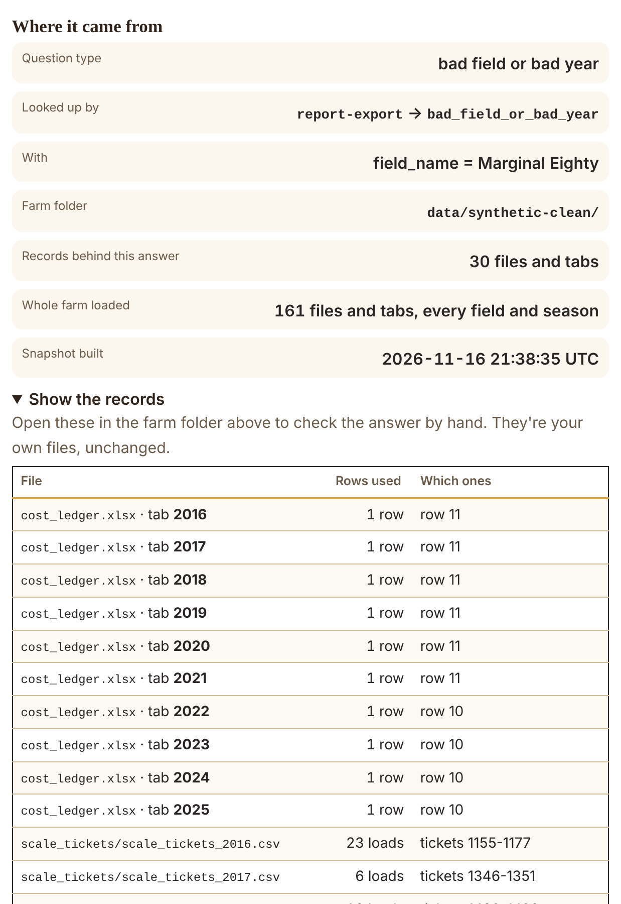

# Your records: where the answers come from

Every answer is worked out from plain files in one folder on your laptop.
There is no hidden database and no cloud copy: the files below are the
records, and you can open any of them in Excel, a text editor or a mapping
program and check an answer by hand. This page lists those files, what
each one must contain if you load your own farm, and how to answer a
grower who doesn't believe the tool yet.

For the overview, see the [README](../README.md). For setup, see the
[Farmer Guide](FARMER_GUIDE.md).

## Where the files are

Each example farm has its own folder inside the project folder:

| Farm | Folder |
|---|---|
| Farm 1 (clean records) | `data/synthetic-clean/` |
| Farm 2 (messy records) | `data/synthetic/` |
| Your own farm | Put your files in `data/synthetic/` in place of Farm 2's ([Step 2 of the Farmer Guide](FARMER_GUIDE.md#step-2-load-your-own-farms-data)) |

Inside each folder:

| File or folder | Format | What it holds | Questions it answers |
|---|---|---|---|
| `cost_ledger.xlsx` | Excel workbook, one tab per season plus `Unit Prices` | Seed, fertilizer, chemical, fuel and cash rent for each field | Profit, bad field or bad year, cost checks |
| `scale_tickets/` | CSV, one file per season | Every load hauled to the elevator: bushels and price | Profit (this is where the bushels come from) and yield checks |
| `yield_monitor/` | CSV, one file per field per season | Combine readings: position, bushels per acre, moisture | Yield checks, which part of a field loses money |
| `as_applied/` | CSV, one file per season | What went on, at what rate and where | What was applied, nitrogen by season, which part of a field loses money |
| `weather/` | CSV, one file per season, plus `soil_awc.csv` | Daily rain and temperature; how much water each field's soil holds | Weather and soil questions, the weather estimate on a bad year |
| `boundaries/` | GeoJSON map file, one per season | Each field's shape, name, crop and acres | Every question: field names and acres come from here |
| `ground_truth.json` | JSON | The answer key the example data was generated with | None. The app never reads it; the tests use it to prove the app's answers are right |

Two more files sit in `data/`, next to the farm folders:

| File | What it holds |
|---|---|
| `data/audit.jsonl` | One line for every question, lookup, AI sentence and confirmation. Each line carries a hash of the one before it, so an edited or deleted line shows |
| `data/confirmed_mappings.json` (Farm 1: `confirmed_mappings_clean.json`) | Every field-name spelling and spreadsheet column you confirmed once with `farm-ingest` |

The app copies these files into memory when it starts and never changes
them.

## Show the records behind an answer

Under each answer, open **The numbers behind it**. **Where it came from**
names the farm folder and how many files and tabs this answer used.
**Show the records** lists each one:

| Column | What it tells you |
|---|---|
| File | The path inside the farm folder, plus the tab for the spreadsheet |
| Rows used | How many rows of that file were used: spreadsheet rows, loads, yield points, passes, days |
| Which ones | Where to look: the spreadsheet row number, the scale-ticket numbers, the products, or "all of it" |

**Whole farm loaded** is a different number: every file and spreadsheet
tab the app read when it started (161 for Farm 1), for every field and
season. Only the files under **Show the records** went into this answer.

### Checking an answer by hand

Profit for one field and season is plain arithmetic on three files:

> profit = (net bushels × price, added up over the field's scale tickets)
> − (seed + fertilizer + chemical + fuel + cash rent per acre) × acres

Acres come from the field's boundary in `boundaries/`, not from the
ledger. For Farm 1's Marginal Eighty in 2025:

| Where | What you find |
|---|---|
| `cost_ledger.xlsx`, tab `2025`, row 10 | $40.56 + $44.24 + $155.11 + $83.41 + $183.45 = $506.77 per acre |
| `boundaries/field_boundaries_2025.geojson` | Marginal Eighty, 165.5 acres, soybean |
| `scale_tickets/scale_tickets_2025.csv`, tickets 2617 to 2623 | 7 loads, 6,351.9 net bushels at $10.54 = $66,949.03 |
| The arithmetic | $66,949.03 − $506.77 × 165.5 = **−$16,921.41**, a loss of $102.24 per acre |

Do this for each season and you have the bad-field-or-bad-year answer:
Marginal Eighty lost money in all 10.

## Answering a skeptical grower

| They ask | Show them |
|---|---|
| "Where did that number come from?" | Open **Show the records** and open the file it names. Do the arithmetic above together. |
| "Did the AI make it up?" | The AI writes no numbers. The answer's first line is written by code from the records. The AI may add one sentence, and **How we checked it** shows the 8 checks it had to pass. **Where it came from** names the exact lookup and field. |
| "What if my records are wrong?" | Switch to Farm 2, the same farm with messy records, and ask "Does the seed cost on Sheyenne Bottom in 2022 look right?". The record checks catch the mistyped seed cost. The tool checks one record against another; it doesn't trust any single one. |
| "Is my data sent anywhere?" | Turn off Wi-Fi and ask again: it still works. The question still shows up in `data/audit.jsonl`, on this laptop. |
| "Could someone change the log?" | Each line in `data/audit.jsonl` carries a hash of the line before it, so a changed or deleted line breaks the chain. |
| "How do you know it's right?" | The example farms were generated with a known answer key (`ground_truth.json`). [The tests](VERIFICATION.md) compare the tool's answers with it, and [EVAL_QUESTIONS.md](EVAL_QUESTIONS.md) lists 15 questions with the right answer written out. |

## The files you need for your own farm

To use your own records, you need the same files with the same names
and column headings as the example farms. The tool reads columns by name,
so a heading must match **exactly** (spelling, capital letters,
punctuation). The order of rows doesn't matter, and your fields, seasons
and number of rows can all differ from the example.

Two things happen when a heading doesn't match. The cost ledger's column
headings go through the same confirm-once step as field names:
`farm-ingest` suggests a match and you check it. Everything else is read
directly by heading, with no confirmation step. A mismatch there stops
with an error instead of misreading your data, but today the error is a
technical one, so do your first load next to someone who won't be thrown
by it.

| File | Required | Columns or contents |
|---|---|---|
| `boundaries/field_boundaries_YYYY.geojson` | Yes, one per season | A GeoJSON FeatureCollection with a `crs` of EPSG:4326 (longitude/latitude) or EPSG:26914 (UTM zone 14N). One Polygon or MultiPolygon feature per field, with properties `field_name`, `acres`, `crop`, `season` |
| `cost_ledger.xlsx`, one tab per season | Yes | Tab named just the year (`2024`, not "Season 2024"). Columns in this order: `Field`, `Crop`, `Acres`, `Seed ($/ac)`, `Fertilizer ($/ac)`, `Chemical ($/ac)`, `Fuel ($/ac)`, `Cash Rent ($/ac)`, `Notes`. If a season records total dollars for the field, name them `Seed (Total $)` and so on; `farm-ingest` asks which it is and remembers |
| `cost_ledger.xlsx`, tab `Unit Prices` | Yes | One row per season, with exactly this header: `Season`, `Seed Corn ($/unit)`, `Seed Soybean ($/unit)`, `N ($/lb)`, `P ($/lb)`, `K ($/lb)`, `Chemical ($/ac)`, `Fuel ($/gal)` |
| `scale_tickets/scale_tickets_YYYY.csv` | Yes, one per season | One row per load: `season`, `ticket_number`, `date`, `field_name`, `crop`, `load_number`, `moisture_pct`, `gross_bushels`, `net_bushels`, `price_per_bu`, `elevator` |
| `yield_monitor/yield_monitor_<field>_YYYY.csv` | For yield and zone questions | One file per field per season. The field and year are in the file name (for example `yield_monitor_east_80_2024.csv`), not in columns. One row per reading: `timestamp`, `lat`, `lon`, `wet_bu_ac`, `dry_bu_ac`, `moisture_pct` |
| `as_applied/as_applied_YYYY.csv` | For applied-input, nitrogen and zone questions | One row per pass: `timestamp`, `field_name`, `product`, `rate`, `rate_unit`, `lat`, `lon` |
| `weather/weather_YYYY.csv` | For weather questions and the bad-year estimate | One row per day: `season`, `date`, `precip_mm`, `temp_min_c`, `temp_max_c` |
| `weather/soil_awc.csv` | For soil questions and the bad-year estimate | One row per field: `field_name`, `awc_in` (the soil's water-holding capacity in inches, from your agronomist or the soil survey) |

Field names don't have to match from file to file. If your ledger says
"north eighty" and your map says "N 80", `farm-ingest` asks you once
whether they are the same field and remembers your answer. The example
farms' files are a complete working example of every row above: when a
heading is unclear, open the same file in `data/synthetic-clean/`.

Once your files are in place, run `farm-ingest` and then `farm-web`, as
described in [Step 2 of the Farmer Guide](FARMER_GUIDE.md#step-2-load-your-own-farms-data).
